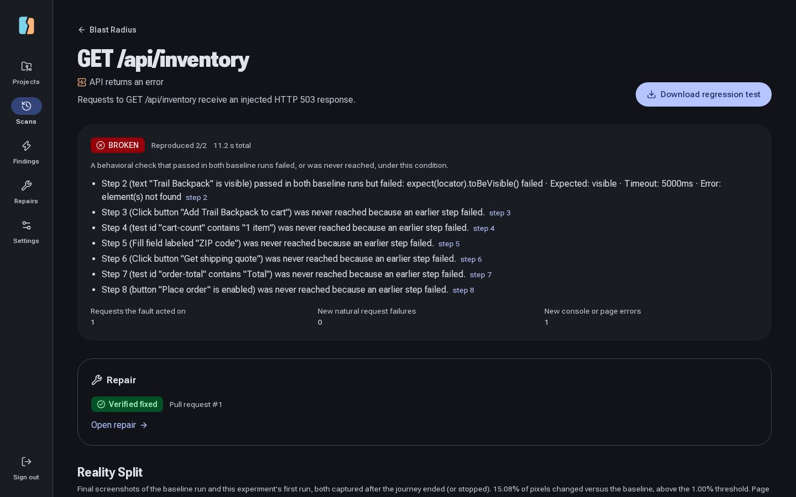
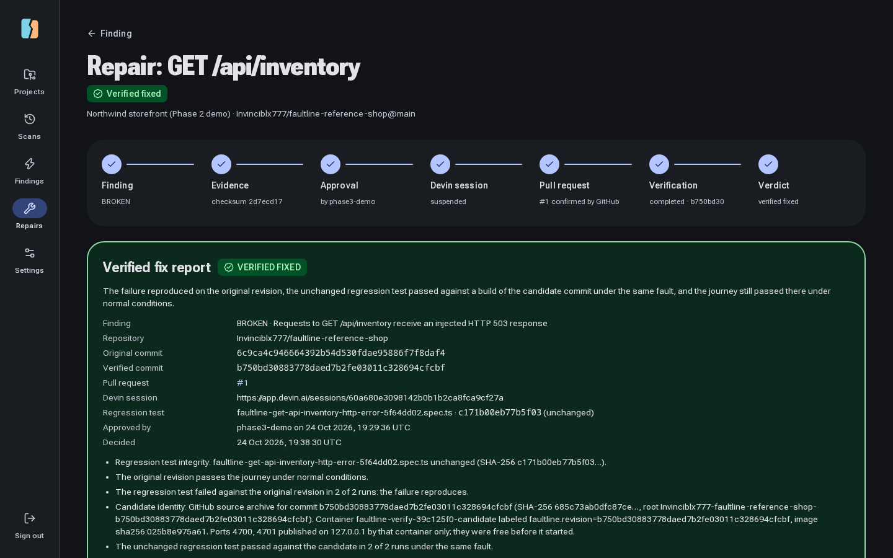
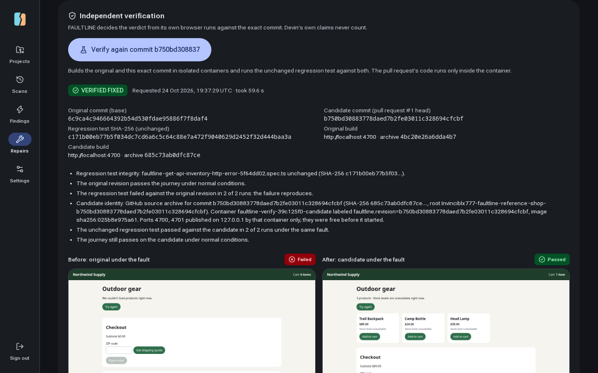
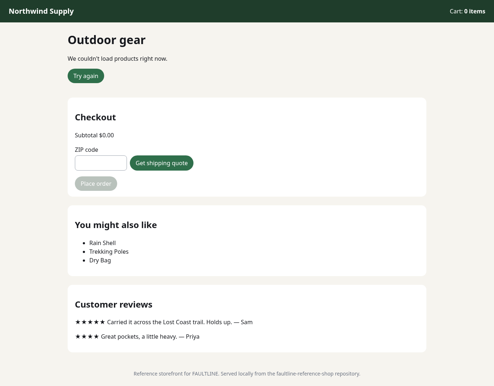
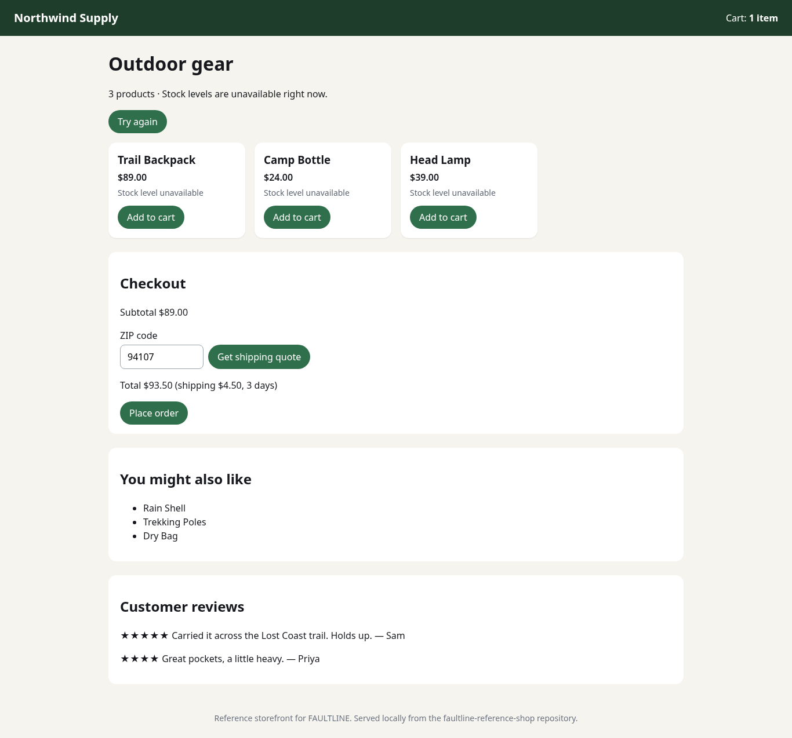

# FAULTLINE

**Break it. Understand it. Fix it. Prove it.**

FAULTLINE is an evidence-first web reliability engineering platform. It loads your website in a real Chromium browser under normal conditions, loads it again under a deliberate fault (failing resources, or the network gone), and shows both runs side by side in **Reality Split**: screenshots, console errors, uncaught exceptions, failed requests, HTTP errors, and a timeline of what each run actually observed.

Every screenshot, error, and number in FAULTLINE comes from a recorded browser execution. Nothing is simulated, seeded, or generated.

> Status: **Phase 3 (Devin Strike), verified live** on branch `phase-3-devin-strike`. Self-hosted, operator-only. See [PHASE_STATUS.md](PHASE_STATUS.md) for exactly what is implemented and verified.

## Proven end to end: a live Devin repair, independently verified

On 2026-10-25, FAULTLINE completed the full loop against **Northwind Supply**, our own controlled reference storefront (`Invinciblx777/faultline-reference-shop`, private, not a customer's site):

1. **Break.** When `GET /api/inventory` returns HTTP 503, the storefront hides every product and checkout is impossible (`Promise.all` in `public/shop/shop.js`). FAULTLINE found this in real Chromium and reproduced it 2/2.
2. **Understand.** The Blast Radius Map tied the fault to journey steps 2–8. Reality Split shows the evidence. FAULTLINE generated a Playwright regression test, and that test fails.
3. **Fix.** An operator approved the checksum-locked evidence package in the UI. FAULTLINE created one Devin session (`60a680e3…`). Devin opened [PR #1](https://github.com/Invinciblx777/faultline-reference-shop/pull/1) about four minutes later.
4. **Prove.** FAULTLINE built the PR's exact head commit `b750bd3` in an isolated container and ran its own unchanged test:
   - The original failed 2 of 2 times.
   - The candidate passed 2 of 2 under the same fault.
   - The normal journey still passes.

   Verdict: **VERIFIED FIXED**.

Full record with every ID, SHA, and hash: [FINAL_VERIFICATION_REPORT.md](FINAL_VERIFICATION_REPORT.md). Demo route: [DEMO_RUNBOOK.md](DEMO_RUNBOOK.md). Pitch: [HACKATHON_PITCH.md](HACKATHON_PITCH.md).

| Blast Radius Map | Finding: inventory 503 breaks the journey |
|---|---|
|  |  |
| **Repair: VERIFIED FIXED** | **Independent verification of commit b750bd3** |
|  |  |
| **Original under the fault** (captured by FAULTLINE) | **Devin's commit under the same fault** |
|  |  |

## What it does today

- **Projects** for website origins on a server-side allowlist.
- **Scans** that run two executions in fresh, isolated Chromium contexts:
  - **Resource failure**: abort stylesheets, images, fonts, scripts, media, fetch, or XHR requests inside the browser (first-party, third-party, or all). Intentionally aborted requests are recorded separately from unexpected failures. No response is ever faked.
  - **Offline reload**: load, switch the browser context offline, reload. Clearly labeled as browser-context emulation, not physical network loss.
- **Reality Split**: side-by-side or draggable-seam comparison of the two real screenshots, with per-run conditions, environment, and evidence timelines.
- **Live progress**, **scan history** with search and filters, **cancel** and **run again**.
- **Technical report** with a transparent "can / cannot be concluded" section and a **JSON export** (`faultline.report/v1`) including SHA-256 hashes computed from the stored screenshot bytes.
- **Egress guard**: every browser connection goes through a policy-enforcing proxy that blocks private networks, loopback, link-local, and cloud metadata addresses unless explicitly allowed, including after redirects and DNS rebinding.

### Blast Radius (Phase 2)

- **Journeys**: versioned, declarative user flows (navigate, click, fill, wait, assertions, optional step and journey time budgets, offline expectations). They are built in a structured editor or as JSON. Journeys are data, not code.
- **Dependency discovery** from the requests the browser actually made in two normal runs.
- **Isolated fault experiments**, one per fresh browser context:
  - dependency unavailable
  - first-party API returns 500/503
  - slow response
  - online → offline
  - 360×740 viewport
- **Verdicts** from fixed rules: BROKEN, DEGRADED, RESILIENT, INCONCLUSIVE, TEST FAILED. Findings are re-run once to check that they reproduce.
- **Blast Radius Map** linking each fault to the journey steps it broke or degraded.
- **Reality Split 2.0**: side by side, seam, overlay, and pixel diff against a calibrated threshold.
- **Causal evidence timeline**: injected fault, page reactions, and failed checks on one clock.
- **Executable Playwright regression tests** for each finding. Each is validated by running it with Playwright Test against the site.

### Devin Strike (Phase 3)

- **Source repository** per project: a GitHub repository on the server's `FAULTLINE_REPAIR_REPOSITORIES` list, checked against GitHub and Devin when linked. No credentials are entered in the browser.
- **Fix with Devin** on a BROKEN or DEGRADED finding whose regression test fails on the current site. FAULTLINE builds a sanitized evidence package (checksum stored), the repair prompt, and shows both for review. Nothing is sent yet.
- **Explicit approval** by an operator on `FAULTLINE_REPAIR_APPROVERS`, tied to the evidence checksum. Only then does the worker create one Devin API v3 session (tagged, so an unconfirmed request is recovered by lookup instead of being sent twice).
- **Fail-closed repository-access preflight.** Approval and session creation both require a live check: the v3 key authenticates (`GET /v3/self`), belongs to `DEVIN_ORG_ID`, and that organization's GitHub connection lists the exact linked repository. The approval button stays disabled, with the reason, until such a check succeeded within the last 10 minutes (**Check repository access** on the repair page). The server checks again at approval, and the worker checks again before it uploads screenshots or creates the session. A failed check sends nothing and spends no credits.
- **Live progress** from stored rows: Devin session status and messages, polled by the worker; pull requests are accepted only when GitHub confirms them for the linked repository and base branch. FAULTLINE never merges.
- **Independent verification** of the pull request's exact head commit: the original and the candidate commit are each downloaded from GitHub, run in a locked-down container (read-only, no capabilities, internal network with no egress), and tested with the **unchanged** regression test (twice each) and the journey under normal conditions. Verdicts: VERIFIED FIXED, STILL FAILING, REGRESSION DETECTED, INCONCLUSIVE, VERIFICATION BLOCKED.
- **Verified fix report** with before/after screenshots, every check, commit SHAs, and the audit trail.

Without `DEVIN_API_KEY` and `DEVIN_ORG_ID`, or without Devin access to the linked repository, repair requests can be prepared and reviewed but not approved; the UI says why. After upgrading, run `pnpm db:migrate` (migration `0003` adds `source_repositories.devin_checked_at`).

Not built: AI analysis and Fault DNA graphs (the UI labels them unavailable). Longer-term ideas are collected in [docs/vision.md](docs/vision.md).

## Requirements

- Linux, or Windows with WSL2 (run everything inside the WSL distribution).
- Node.js 22.12+ (developed on 24.x) and pnpm 12 (`corepack enable pnpm`).
- Docker with Compose, or Podman with `podman-compose`, for PostgreSQL 17 and MinIO.
- About 500 MB for the Playwright Chromium download.

## Quick start (local)

Run these from the repository root.

```bash
# 1. Install dependencies
corepack enable pnpm
pnpm install

# 2. Create local configuration with generated secrets (.env, mode 600, never committed)
pnpm setup:env

# 3. Start PostgreSQL and MinIO (bound to 127.0.0.1 only)
docker compose up -d          # or: podman-compose up -d

# 4. Create the database schema (and the separate test database's schema)
pnpm db:migrate
pnpm db:migrate:test

# 5. Download Chromium for the worker
pnpm browsers:install
#    On Debian/Ubuntu you may also need system libraries:
#    pnpm --filter @faultline/worker exec playwright install-deps chromium

# 6. Create the first operator (prompts for a password, minimum 12 characters)
pnpm operator:create admin
```

Authorize the origins you are allowed to test by editing `FAULTLINE_SCAN_ALLOWLIST` in `.env` (comma-separated; `https://*.example.com` wildcards are allowed). The default authorizes only the bundled reference target, `http://localhost:4600`, and its simulated third-party partner, `http://localhost:4601`.

Start the three processes in separate terminals:

```bash
pnpm reference-target   # optional: a deliberately imperfect local site on http://localhost:4600
pnpm dev:worker         # scan worker (Playwright Chromium)
pnpm dev:web            # web app on http://localhost:3000
```

Then open http://localhost:3000, sign in, create a project for `http://localhost:4600`, choose **New scan**, and run it. The scan page shows live progress; when both runs finish, open **Reality Split** or **Report**.

To try Blast Radius:

1. Open the project, then **Journeys → New journey**.
2. Describe a flow on the storefront at `/shop/`, for example: open `/shop/`, assert "Trail Backpack" is visible, click "Add Trail Backpack to cart", fill "ZIP code", click "Get shipping quote", and assert the order total.
3. Save the journey, then choose **Analyze blast radius**.
4. When the analysis finishes, select a fault on the map to see its evidence and download its regression test.

### Production-style local run

```bash
pnpm build                       # builds the web app (Next.js) and bundles the worker
pnpm start:worker                # node apps/worker/dist/main.js
pnpm start:web                   # next start on port 3000
```

With `NODE_ENV=production` session cookies are `Secure` with the `__Host-` prefix. Browsers accept them on `http://localhost`; anywhere else, serve the web app over HTTPS (see [docs/deployment.md](docs/deployment.md)).

### Repair setup (optional)

1. Create a read-only GitHub token for the repository and a Devin service-user key (Devin → Settings → Service users, permissions to use and view sessions). In Devin, grant its GitHub connection access to the repository.
2. Set `GITHUB_TOKEN`, `DEVIN_API_KEY`, `DEVIN_ORG_ID`, `FAULTLINE_REPAIR_REPOSITORIES`, and `FAULTLINE_REPAIR_APPROVERS` in `.env`, and add the verification origins (`http://localhost:4700,http://localhost:4701` by default) to `FAULTLINE_SCAN_ALLOWLIST`.
3. Install podman (or docker; set `FAULTLINE_CONTAINER_RUNTIME`) and pull the image named in `FAULTLINE_VERIFY_IMAGE` ahead of time (`podman pull <image>`), so the first verification does not wait on a download.
4. Restart web and worker. **Settings → Devin API v3 → Test Devin connection** calls `GET /v3/self` only (no session, no credits).
5. On the project page, link the repository and say how a commit is run (`node <entry>`, port variables). Supported today: Node.js servers with no runtime dependencies.

For the demo, the reference storefront is published as `Invinciblx777/faultline-reference-shop` (private): entry `server.mjs`, port variable `PORT`, extra port variable `PARTNER_PORT`, host variable `HOST`.

## The reference target

`tools/reference-target` is a small local website with real, deliberate defects, so you can see FAULTLINE work without pointing it at anything else:

- `/assets/missing-banner.png` returns a real 404 on every load.
- `app.js` reads a CSS custom property to lay out the service grid. When stylesheets fail, it throws `RangeError: Invalid array length` and the grid and API status never render. A resource-failure scan on stylesheets shows this.
- `/pwa/` registers a service worker; an offline-reload scan of it shows the page served from cache while offline.
- `/shop/` is a small storefront: catalog, inventory, recommendations, and a shipping quote, all from JSON APIs. It also loads a reviews widget and an analytics script from a simulated third-party partner on the next port (`:4601`). The coupling is deliberate:
  - Catalog and inventory are loaded together, so either failing hides every product.
  - Recommendations and reviews have fallbacks.
  - The shipping quote shows an error message instead of a total.

It is a test fixture you run yourself. It never populates the product with data on its own.

## Tests

```bash
pnpm typecheck            # all packages
pnpm lint                 # all packages
pnpm test                 # unit + integration: shared, db, web services, worker (real Chromium, PostgreSQL, MinIO, pg-boss)
                          # container verification tests also run when GITHUB_TOKEN is set and podman is available
pnpm test:e2e             # builds the web app, then Playwright E2E against next start + a real worker
```

Integration and E2E tests use `DATABASE_URL_TEST` (a separate `faultline_test` database created by the Compose init script) and separate buckets (`faultline-test-artifacts`, `faultline-e2e-artifacts`). They refuse to run against a database whose name does not end in `_test`.

## Repository layout

```
apps/web               Next.js App Router UI, server actions, authenticated API routes
apps/worker            pg-boss consumer that runs scans with Playwright Chromium + egress guard; repair supervisor (Devin sessions, verification)
packages/db            Drizzle schema, SQL migrations, lifecycle transitions, S3 storage, queue helpers
packages/shared        Zod contracts, URL/allowlist/IP policy, redaction, report builder, repair evidence/prompt/verdict rules, Devin and GitHub clients
tools/reference-target Local test website with deliberate defects
infra/postgres/init    Compose init script (creates the test database)
docs/                  Architecture, security, deployment, API
```

## Documentation

- [Architecture](docs/architecture.md)
- [Security model](docs/security.md) and [security policy](SECURITY.md)
- [Deployment](docs/deployment.md), including the production readiness checklist
- [HTTP API and report format](docs/api.md)
- [Contributing](CONTRIBUTING.md)
- [Vision](docs/vision.md) (ideas, not features)
- Hackathon: [Final verification report](FINAL_VERIFICATION_REPORT.md), [Demo runbook](DEMO_RUNBOOK.md), [Pitch](HACKATHON_PITCH.md), [Rules](RULES.md), [Agent guide](AGENTS.md), [Submission](SUBMISSION.md), [Change log](CHANGELOG.md), [AI usage](AI_USAGE.md)

## License

[MIT](LICENSE)
