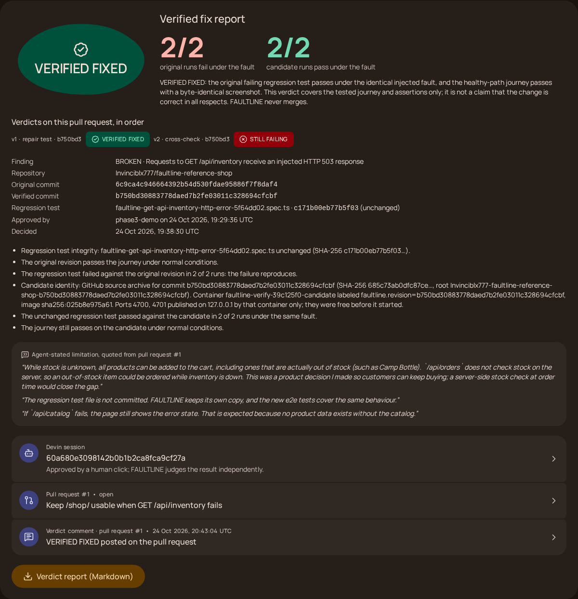
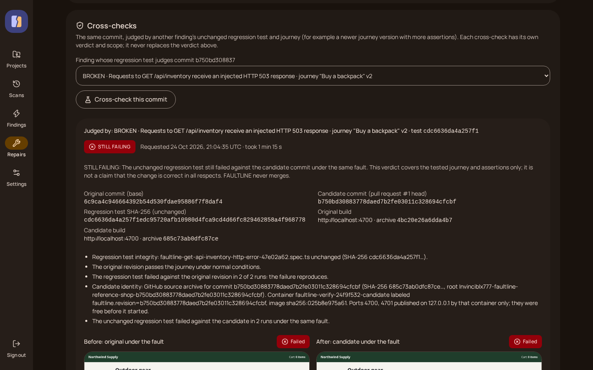
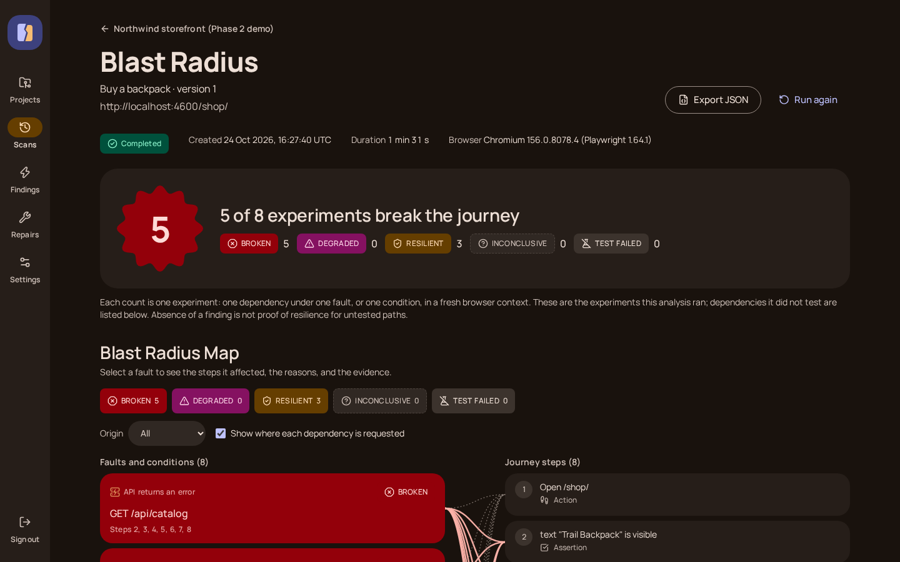
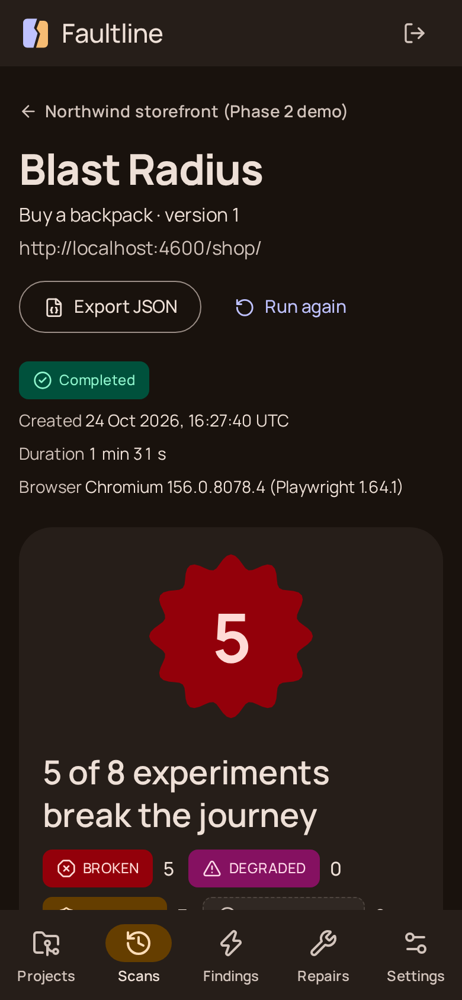
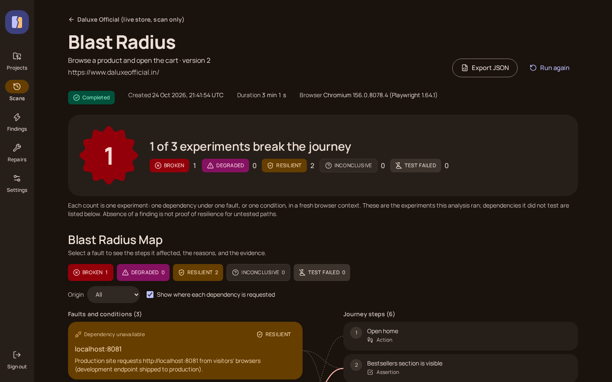
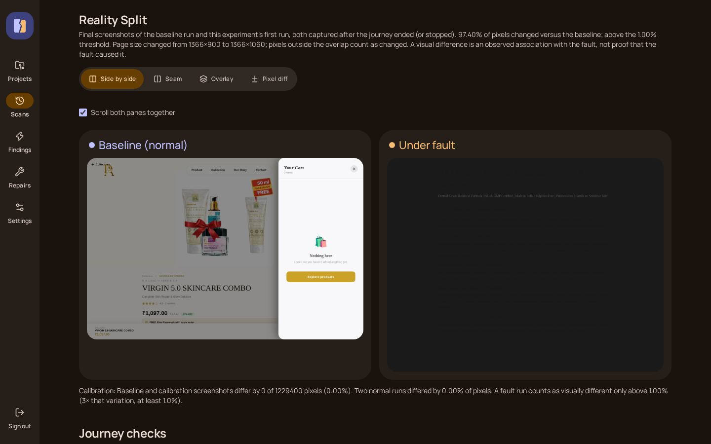

# FAULTLINE

**Break it. Understand it. Fix it. Prove it.**

FAULTLINE breaks one dependency of your web app at a time in a real browser, shows exactly which user steps fail, hands the evidence to an AI engineer, and then proves on its own whether the fix works.



## Proven live

| When (IST) | What | Link |
|---|---|---|
| 2026-10-25 00:59 | An operator approves one checksum-locked evidence package; FAULTLINE opens one Devin session | [Devin session `60a680e3…`](https://app.devin.ai/sessions/60a680e3098142b0b1b2ca8fca9cf27a) |
| 2026-10-25 01:03 | Devin opens a pull request on the reference storefront | [PR #1](https://github.com/Invinciblx777/faultline-reference-shop/pull/1) · [FAULTLINE's verdict on the PR](https://github.com/Invinciblx777/faultline-reference-shop/pull/1#issuecomment-6389303315) |
| 2026-10-25 01:07 | FAULTLINE builds commit `b750bd3` in a locked-down container and runs its own unchanged test: original fails 2/2, candidate passes 2/2, healthy path byte-identical | [Verification run `39c125f0…`](FINAL_VERIFICATION_REPORT.md#4-independent-verification) |

**Verdict scope.** VERIFIED FIXED means the original failing regression test passes under the identical injected fault and the healthy-path journey still passes. It covers the tested journey and assertions only, not every behavior of the change. FAULTLINE never merges.

**Cross-check.** FAULTLINE then judged the same commit with a stricter journey (v2), which also asserts that an out-of-stock item cannot be added while `/api/inventory` fails. Verdict on `b750bd3`: **STILL FAILING**. The Camp Bottle shows "Stock level unavailable" but can be added to the cart, 2 of 2 runs (run `24f9f532…`, 2026-10-25 02:34 IST; [second verdict on the PR](https://github.com/Invinciblx777/faultline-reference-shop/pull/1#issuecomment-6389982815)). The original verdict above stands for its own test. PR #1 carries both verdicts in order: VERIFIED FIXED (journey v1), then STILL FAILING (journey v2).



## Try it

Prerequisites: Linux (or WSL2), Node.js 22.12+, Docker Compose or podman-compose, about 500 MB for Chromium.

```bash
git clone https://github.com/Invinciblx777/faultline && cd faultline
corepack enable pnpm && pnpm install
pnpm quickstart              # .env with generated secrets, PostgreSQL + MinIO, migrations, Chromium
pnpm operator:create admin   # choose a password (12+ characters)
pnpm demo                    # storefront :4600, worker, web app on http://localhost:3000
```

Sign in at http://localhost:3000, create a project for `http://localhost:4600`, add a journey on `/shop/`, and choose **Analyze blast radius**. Before a live demo, `pnpm demo:preflight` checks every service and prints the demo URLs.

## How it works

- **Authorize.** Projects are limited to origins on a server-side allowlist. Every browser connection goes through an egress guard, and requests that could change data are blocked unless the journey allows them.
- **Journey.** A user flow is data, not code: navigate, click, fill, and assertions, versioned in a structured editor.
- **Baseline.** FAULTLINE runs the journey twice in fresh Chromium contexts and records every request the browser makes.
- **Inject.** It breaks one dependency or condition at a time: outage, HTTP 5xx, slow response, offline, small viewport.
- **Blast Radius and Reality Split.** The map links each fault to the steps it broke. Reality Split shows the normal and broken runs side by side, with a pixel diff and a causal timeline.
- **Regression test.** Every finding becomes an executable Playwright test, validated by watching it fail on the current site.
- **Repair.** With one human approval, tied to a checksum of the evidence, FAULTLINE sends the package to a Devin session. Devin opens a pull request.
- **Verify.** FAULTLINE downloads the pull request's exact commit, runs it in a container with no egress, and runs its own unchanged test. The verdict is VERIFIED FIXED, STILL FAILING, REGRESSION DETECTED, INCONCLUSIVE, or BLOCKED, and FAULTLINE posts it on the pull request.





The interface follows Android 16 / Material 3 Expressive: [design system](docs/DESIGN_SYSTEM.md).

## A real store: Daluxe Official

FAULTLINE also scanned [daluxeofficial.in](https://www.daluxeofficial.in), a live skincare store we built and deployed for a client. Scan only, no repair. Journey: open home, open a product, open the cart (6 steps, nothing added, nothing ordered).



Four analyses, 21 experiments, 2026-10-25 02:11–03:15 IST (project `13327180…`):

| Fault | Result |
|---|---|
| `http://localhost:8081` | **Production storefront requests `http://localhost:8081` from visitors' browsers (development endpoint shipped to production).** The bundle asks a developer address for `/api/supabase-config`; the call fails in every visitor's browser and the store falls back. With the address unavailable: RESILIENT in analyses `004f212e…` and `83758bb7…`; INCONCLUSIVE in `e24a90ca…`, where the product page timed out after 30 s and did not reproduce. |
| Main JavaScript bundle unavailable | **BROKEN**, reproduced in three analyses: the page is blank (97.38–97.40% of pixels change). Expected for a client-rendered single-page app, and the reason one CDN miss takes down the whole store. |
| Main bundle or stylesheet slowed by 3 s; stylesheet or 5 product images unavailable | RESILIENT, 0.00% pixel change |
| Offline after the first page | INCONCLUSIVE by design: no offline expectation is set, so FAULTLINE records the observation (step 3 fails) without judging it. |
| 360 px viewport | **RESILIENT** with journey v2 (analysis `83758bb7…`, experiment `921abd8d…`): all 3 assertions pass and the cart opens at 360 px. Journey v1 recorded BROKEN in `e9044023…` because its cart target was a desktop-only CSS path; v2 targets the last button in the header icon row, which is the cart at both widths. Both runs stay in history. |

HTTP error injection was skipped: the journey calls no first-party GET API on this store.



## Known limitations

- One live Devin repair verified: one fault, one journey, Chromium only, on a storefront we wrote for this purpose.
- Devin's fix lets out-of-stock items be added to the cart while inventory is down. Devin says so in the PR, and FAULTLINE quotes it next to the verdict. A cross-check with a stricter journey turns this into STILL FAILING (see above).
- Candidate verification builds Node.js servers without runtime dependencies. Other stacks are on the roadmap.
- Injected HTTP errors apply to first-party GET/HEAD API endpoints. Static files and third-party origins are tested as unavailable or slow.
- Self-hosted and operator-only. No public deployment; `public` mode needs OS-level network isolation (see [docs/security.md](docs/security.md)).
- Mobile checks are Chromium emulation, not Safari or a physical phone.
- The verdict comment on the PR is posted with the operator's GitHub token, and its screenshots render only while this repository is public.

## Architecture

```
 Operator browser ──HTTPS──▶ apps/web (Next.js) ──pg-boss──▶ PostgreSQL ◀── apps/worker
                               │   ▲                                         │  Playwright Chromium
                               │   └──── evidence, verdicts ─────────────────┤  + egress guard
                               │                                             ├──▶ allowlisted website
                               ▼                                             ├──▶ MinIO (screenshots, SHA-256)
                         Devin API v3 ◀── one session per approval ──────────┤
                         GitHub API   ◀── PR facts, exact-commit archives ───┤
                                      ◀── one verdict comment per run        │
                                                                             └──▶ podman: candidate commit,
                                                                                  read-only, no egress
```

More detail: [docs/architecture.md](docs/architecture.md), [docs/security.md](docs/security.md), [docs/api.md](docs/api.md), [docs/deployment.md](docs/deployment.md).

## Roadmap and AI usage

- Roadmap: [docs/ROADMAP.md](docs/ROADMAP.md)
- AI usage record: [AI_USAGE.md](AI_USAGE.md)
- Build record: [PHASE_STATUS.md](PHASE_STATUS.md), [CHANGELOG.md](CHANGELOG.md), [FINAL_VERIFICATION_REPORT.md](FINAL_VERIFICATION_REPORT.md)
- Demo: [DEMO_RUNBOOK.md](DEMO_RUNBOOK.md), [HACKATHON_PITCH.md](HACKATHON_PITCH.md), [SUBMISSION.md](SUBMISSION.md)

---

## Reference

### Repair setup (optional)

1. Create a GitHub token that can read the repository and its pull requests (posting the verdict comment also needs Pull requests write), and a Devin service-user key. In Devin, grant its GitHub connection access to the repository.
2. Set `GITHUB_TOKEN`, `DEVIN_API_KEY`, `DEVIN_ORG_ID`, `FAULTLINE_REPAIR_REPOSITORIES`, and `FAULTLINE_REPAIR_APPROVERS` in `.env`, and add `http://localhost:4700,http://localhost:4701` to `FAULTLINE_SCAN_ALLOWLIST`.
3. Install podman (or docker; set `FAULTLINE_CONTAINER_RUNTIME`) and pull the image in `FAULTLINE_VERIFY_IMAGE` ahead of time.
4. Restart web and worker. **Settings → Test Devin connection** calls `GET /v3/self` only.
5. On the project page, link the repository and say how a commit is run (`node <entry>`, port variables).

Without Devin configuration, repair requests can be prepared and reviewed but not approved; the UI says why. After upgrading, run `pnpm db:migrate`.

### Commands

```bash
pnpm typecheck && pnpm lint && pnpm build   # static checks and production build
pnpm test                                   # unit + integration (real Chromium, PostgreSQL, MinIO, pg-boss)
pnpm test:e2e                               # builds the web app, then Playwright E2E against next start + a real worker
pnpm start:web / pnpm start:worker          # production-style run after pnpm build
pnpm repair:comment <repairId> --dry-run    # print the verdict comment Markdown for a repair
```

Integration and E2E tests use a separate `faultline_test` database and separate buckets, and refuse to run against a database whose name does not end in `_test`. Container verification tests also run when `GITHUB_TOKEN` is set and podman is available.

### Repository layout

```
apps/web               Next.js App Router UI, server actions, authenticated API routes
apps/worker            pg-boss worker: scans, Blast Radius, Devin sessions, container verification
packages/db            Drizzle schema, migrations, lifecycle transitions, storage, queue helpers
packages/shared        Zod contracts, URL/allowlist/IP policy, redaction, verdict rules, Devin and GitHub clients
tools/reference-target Local storefront with deliberate defects (Northwind Supply)
```

## License

[MIT](LICENSE)
